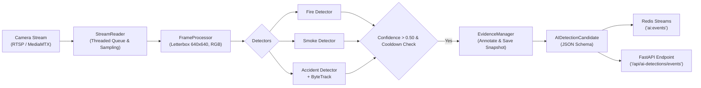

# AI & Computer Vision Models Documentation [M2]

This document details the architecture, models, processing pipeline, and evaluation protocols for the **AI Worker** in the **Social Empowerment Platform**.

---

## 📌 Core Architectural Principle

> **An AI detection is an event candidate, not a confirmed emergency.**  
> Human review by the **Handler** is strictly required in the single Handler Dashboard before any consequential action (such as dispatch, notification, or emergency escalation) takes place.

---

## 🛠️ Detection Scope & Models Overview

The AI monitoring worker analyzes video streams from registered webcams/CCTV feeds and detects three specific event categories:

| Category | Primary Model / Technique | Fallback / Heuristic | Primary Targets |
|---|---|---|---|
| **Fire Detection** | YOLOv8-Fire (Fine-tuned Ultralytics) | HSV Flame Color Segmentation + Contour Energy | Open flames, wild flames, burning materials |
| **Smoke Detection** | YOLOv8-Smoke (Fine-tuned Ultralytics) | Diffuse Texture + Low Saturation + Laplacian Blur | Heavy smoke plumes, haze clouds, dark billowing smoke |
| **Road Accident** | YOLOv8-Vehicle + ByteTrack Trajectory Analyzer | Intersection-over-Union (IoU) Collision + Aspect Ratio Rollover | Vehicle collisions (cars, trucks, motorcycles, buses), crashes |

---

## 🔄 End-to-End Processing Pipeline



### 1. Ingestion & Frame Sampling (`services/ai-worker/ingestion/`)
- **Non-blocking capture**: `StreamReader` runs a dedicated thread that pulls frames from OpenCV's `VideoCapture` with `CAP_PROP_BUFFERSIZE = 1`. This prevents latency buildup in RTSP/WebRTC streams.
- **Dynamic Sampling**: Default sampling rate is set to **3.0 FPS** (`SAMPLE_FPS=3.0`). Real-world emergency incidents develop over seconds; sampling 2–5 FPS drastically conserves GPU/CPU without missing events.

### 2. Preprocessing (`services/ai-worker/preprocessing/`)
- **Letterboxing**: Resizes the input frame to `640 x 640` while maintaining the original aspect ratio and padding with neutral gray `(114, 114, 114)` to prevent distortion.
- **Coordinate Transformation**: Detectors compute bounding boxes on the letterboxed input, which are automatically mapped back to original native video coordinates for evidence storage and display.

---

## 🎯 Model Specifications

### 1. Fire Detector (`services/ai-worker/detectors/fire/`)
- **Input**: `(B, 3, 640, 640)` normalized RGB tensor or BGR OpenCV frame.
- **Neural Model**: YOLOv8 nano / small fine-tuned on Fire datasets (FLAME / Roboflow Fire-v2).
- **Computer Vision Fallback**:
  - HSV range: $H \in [0, 25] \cup [165, 180]$, $S \in [120, 255]$, $V \in [180, 255]$.
  - Area threshold: Minimum 150 px contours.
- **Temporal Consistency Filter**: Requires fire candidate persistence over $\ge 2$ consecutive sampled frames within a rolling 3-frame window ($1$ second window) to eliminate transient reflections, camera flashes, or car headlights.

### 2. Smoke Detector (`services/ai-worker/detectors/smoke/`)
- **Input**: `(B, 3, 640, 640)` RGB tensor.
- **Neural Model**: YOLOv8-Smoke.
- **Computer Vision Fallback**:
  - Diffuse low-saturation mask ($S \le 50$, $V \in [70, 230]$).
  - Spatial Laplacian variance $\text{Var}(\nabla^2 I)$: Smooth, low edge variance confirms soft smoke texture rather than hard object edges.
- **Temporal Consistency Filter**: 4-frame moving window ensuring plumes expand or persist before triggering an event candidate.

### 3. Road Accident Detector (`services/ai-worker/detectors/accident/`)
- **Architecture**:
  - Phase 1: **Vehicle Detection** using YOLOv8 COCO classes (`car`, `motorcycle`, `bus`, `truck`).
  - Phase 2: **Object Tracking (`ByteTrack` / IoU Tracker)** assigning persistent `tracker_id` and tracking velocity vectors.
  - Phase 3: **Kinematic Collision Analysis**:
    $$\text{IoU}(\text{Box}_1, \text{Box}_2) \ge 0.10 \quad \land \quad \Delta v \text{ (abrupt deceleration)}$$
  - Also detects abnormal vehicular bounding box aspect ratios corresponding to overturned/rolled vehicles.
- **Output**: Unified bounding box enclosing all involved vehicles, confidence score, and involved vehicle IDs.

---

## 📦 AI Event Candidate Contract

Published to **Redis Streams** (`ai:events`) and forwarded to the Incident Engine.

```json
{
  "event_id": "9b1deb4d-3b7d-4bad-9bdd-2b0d7b3dcb6d",
  "detection_type": "fire",
  "confidence": 0.88,
  "timestamp": "2026-11-21T12:00:00Z",
  "camera_id": "cam_01",
  "location_reference": "Main Street North Intersection",
  "evidence_reference": "/evidence/20261121/cam_01/9b1deb4d-3b7d-4bad-9bdd-2b0d7b3dcb6d.jpg",
  "bounding_boxes": [
    {
      "x1": 120.5,
      "y1": 85.0,
      "x2": 240.0,
      "y2": 190.5,
      "confidence": 0.88,
      "label": "fire",
      "tracker_id": null
    }
  ],
  "metadata": {
    "detector_count": 1,
    "resolution": "1920x1080",
    "detector": "yolo"
  }
}
```

---

## 🛡️ False-Positive Mitigation

To prevent alert fatigue on the Handler Dashboard, the AI Worker applies a 4-tier filtering strategy:

1. **Confidence Thresholding**: Detections below `DETECTION_CONFIDENCE_THRESHOLD` (default: `0.50`) are discarded.
2. **Temporal Persistence**: Heuristic detectors require multi-frame confirmation across temporal sliding windows (minimum 2 out of 3 frames).
3. **Event Cooldown**: A per-camera, per-type cooldown (default: `5.0s`) prevents dispatching dozens of duplicate candidates for an ongoing incident.
4. **Annotated Evidence Watermarking**: Bounding boxes, camera IDs, and UTC timestamps are stamped directly into the JPEG evidence so the Handler can immediately spot artifacts or false alarms during review.

---

## 🧪 Testing & Evaluation

### Running Tests Locally
From `services/ai-worker/`:
```bash
python -m unittest discover tests
```

### Key Test Scenarios:
- **`test_detectors.py`**: Verifies detection accuracy, confidence bounds, and temporal smoothing across simulated frames.
- **`test_stream_reader.py`**: Verifies frame ingestion queue and sample FPS timing.
- **`test_preprocessing.py`**: Verifies letterboxing, normalization, and bounding box coordinate inversion.
- **`test_events.py`**: Verifies evidence snapshot generation, watermarking, and Redis Stream serialization/deserialization.
